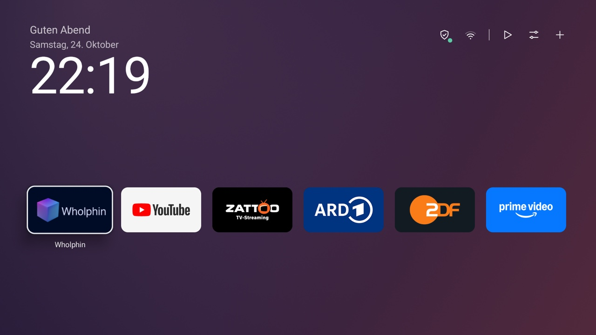
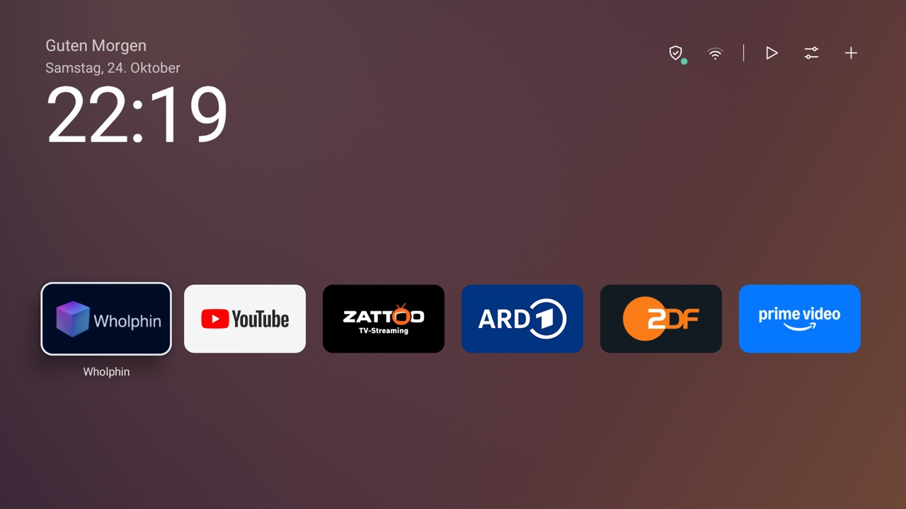
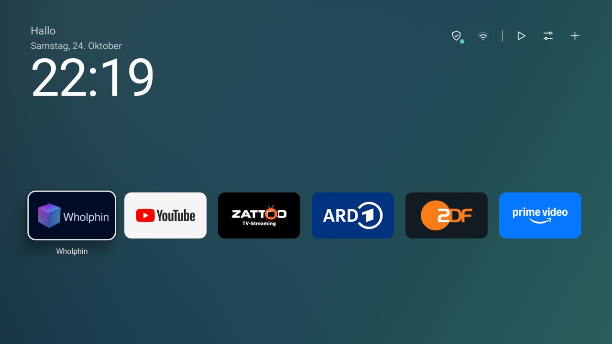
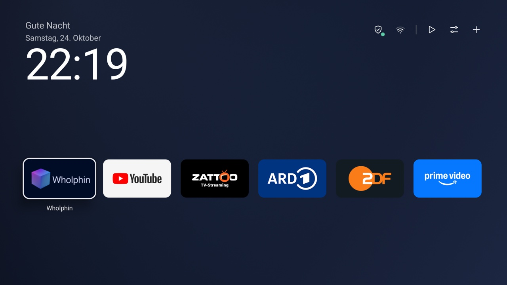
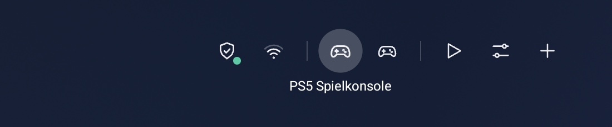
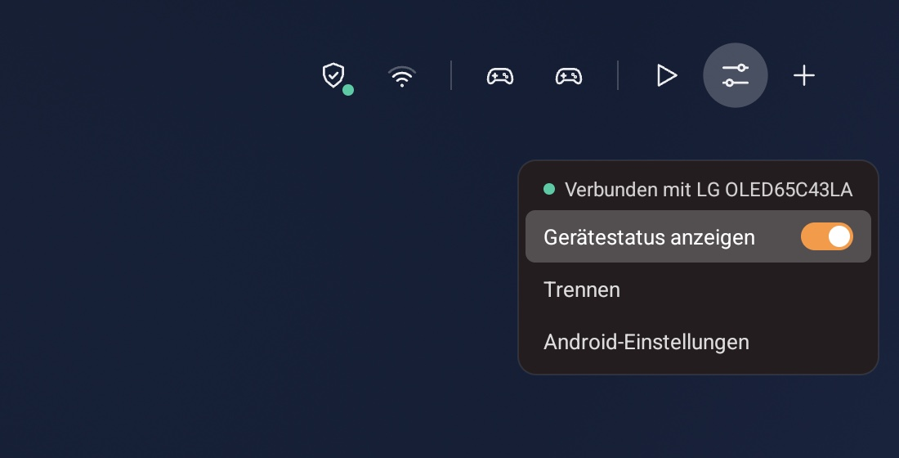
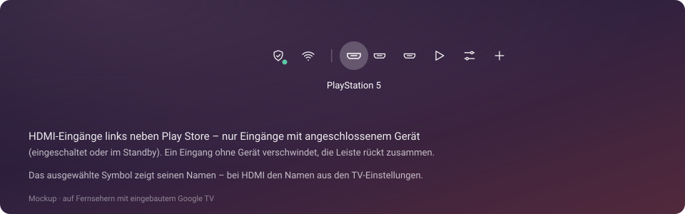
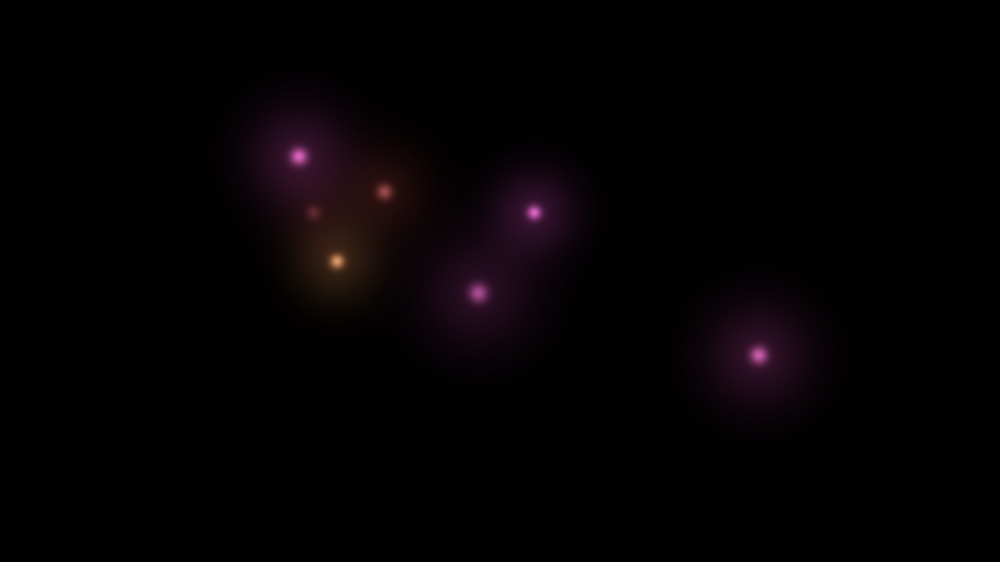

# Calm Google TV

Ein aufgeräumter, schneller Google TV: ohne Werbung, mit ruhigem eigenem Startbildschirm, einem
Glühwürmchen-Bildschirmschoner für OLED und sinnvoll belegten Fernbedienungstasten.
Einrichten geht am einfachsten mit [Claude Code](https://claude.com/claude-code) (fragt vor jeder Änderung)
oder mit einem Skript – und alles lässt sich wieder rückgängig machen. Nichts wird gelöscht.

> **Hinweis:** Das ist ein privates Bastelprojekt, kein offizielles Produkt. Es hat auf meinem TV gut
> funktioniert; die Nutzung erfolgt auf eigene Verantwortung.

Entwickelt und getestet auf einem **Google TV Streamer (Android 14)** an einem **LG-OLED (4K)**.
Auf anderen Google-TV-Geräten sollte das meiste genauso funktionieren (siehe „Andere Geräte“).



### Der Hintergrund folgt der Tageszeit

| Morgen (5–11 Uhr) | Tag (11–17 Uhr) |
|---|---|
|  |  |
| **Abend (17–22 Uhr)** | **Nacht (22–5 Uhr)** |
|  |  |

<sub>Für die Fotos wurde die Tageszeit per Testschalter umgestellt, deshalb zeigt die Uhr überall dieselbe Zeit.
Echte Bildschirmfotos vom TV in 1080p; auf dem Fernseher selbst sind die Verläufe noch weicher.</sub>

### Symbolleiste oben rechts


Das ausgewählte Symbol zeigt seinen Namen – beim Tailscale-Schild auch, ob das VPN gerade an ist, beim
Netzwerk „WLAN“, „Ethernet“ oder „Offline“. Der grüne Punkt am Schild heißt: VPN verbunden.


### Konsolen und andere HDMI-Geräte (LG-Fernseher)



Hängt der Streamer an einem **LG-Fernseher (webOS)**, zeigt die Leiste die anderen HDMI-Geräte am
Fernseher – zwischen zwei Trennstrichen, links neben Play Store. **OK** schaltet den Fernseher auf das
Gerät um (die PS5 wacht dabei per HDMI-CEC auf), **Home** auf der Google-Fernbedienung bringt dich zurück.

- **Welche Geräte:** alle, die der LG kennt (eingerichtet, umbenannt oder per CEC gesehen) oder die gerade
  an sind. Automatisch weggelassen: der Eingang des Streamers selbst (erkannt an seinem Gerätenamen,
  also auch nach dem Umstecken) und Soundbars am ARC-Anschluss. Vergisst der LG ein Gerät, verschwindet
  es auch hier; steckt ein anderes Gerät im Port, übernimmt die Leiste dessen Namen.
- **Symbol** nach der Geräteart, die der LG meldet: Controller für Spielkonsolen, Box mit Play-Zeichen für
  Streaming-/Set-Top-Boxen, Scheibe für Blu-ray/DVD, Laptop für PCs, sonst ein HDMI-Stecker.
  (Getestet sind nur Konsolen; die anderen Arten hängen davon ab, wie der LG sie benennt.)
  **Name** beim Auswählen: der Name aus dem LG, z. B. „PS5 Spielkonsole“.
- **Oranger Punkt:** das Gerät meldet sich als „an“. Der LG unterscheidet dabei nicht zwischen „läuft“ und
  „Ruhemodus“ – nach dem Wechsel in den Ruhemodus zeigt er ein Gerät oft noch einige Minuten als „an“.
  In dieser Zeit weckt das Umschalten es nicht; dann einfach die PS-Taste am Controller drücken.
  Komplett ausgeschaltete Geräte haben keinen Punkt.

**Einrichten:** Auf dem Startbildschirm das **Zahnrad auswählen und OK gedrückt halten** (oder die
Menü-Taste) → **Fernseher verbinden** → am LG mit der LG-Fernbedienung **Zulassen**. Mit Claude Code geht es
auch per `sh tvctl.sh lg-pair <IP>`. Im selben Menü: Gerätestatus (oranger Punkt) ein/aus, Trennen.

**Mehrere LG-Fernseher im Netz:** Das Menü zeigt „Fernseher verbinden“ einmal pro Fernseher, jeweils mit
dessen Namen und Modell (z. B. „TV · OLED65C43LA“; den Namen stellst du am LG unter *Allgemein → Geräte →
TV-Name* ein). Den richtigen auswählen – war es der falsche, einfach über dasselbe Menü trennen und den
anderen wählen. Per Claude Code: `sh tvctl.sh lg-pair <Streamer-IP> <LG-IP>`. Bekommt der LG später eine neue
IP-Adresse, findet der Startbildschirm genau diesen Fernseher wieder (an seiner festen Geräte-ID).



<sub>Getestet mit einem LG OLED65C4 (2024) und PS5 / Nintendo Switch. Der Startbildschirm spricht nur im
Heimnetz mit dem LG und nur, solange er sichtbar ist; nichts geht ins Internet. Falls der LG nicht gefunden
wird: Streamer und LG im selben Netz, am LG „LG Connect Apps“ bzw. „Mobile TV On“ einschalten. Antwortet der LG
nicht auf die übliche Suche (kommt vor), sucht der Startbildschirm im eigenen Heimnetz nach ihm. Andere
Fernseher-Marken zeigen keine Geräte in der Leiste.</sub>

**Auf Fernsehern mit eingebautem Google TV** (statt eines Streamers) zeigt die Leiste die HDMI-Eingänge des
Fernsehers selbst, an denen ein Gerät hängt – ohne Punkt, weil Android dort keinen Gerätestatus liefert.



<sub>Mockup – dieser Teil ist noch auf keinem Fernseher mit eingebautem Google TV getestet.
Zum Ausprobieren: `mockups/symbolleiste-hdmi.html` im Browser öffnen.</sub>

### Bildschirmschoner „Glühwürmchen“



<sub>Abends und nachts warm, tagsüber bunt. Die Lichter schweben langsam und bleiben in der Bildmitte.
In Bewegung ausprobieren: `mockups/bildschirmschoner-gluehwuermchen.html` im Browser öffnen.</sub>

## Schnellstart: ein Prompt, Claude macht den Rest

1. Am Fernseher den Entwicklermodus einschalten (siehe [Schritt 2](#2-am-fernseher-entwicklermodus-einmalig-2-min)) –
   oder Claude führt dich durch.
2. [Claude Code](https://claude.com/claude-code) auf dem Computer öffnen, in einem leeren Ordner.
   Computer und TV müssen im selben WLAN sein.
3. Diesen Prompt einfügen, `<IP>` und `<deine Apps>` ersetzen (beides darf auch leer bleiben – Claude fragt):

```text
Hol dir das Projekt https://github.com/qtmo0/calm-google-tv mit
"git clone https://github.com/qtmo0/calm-google-tv.git" in diesen Ordner,
wechsle hinein und lies dort zuerst CLAUDE.md und README.md vollständig.

Richte dann damit meinen Google TV ein. IP-Adresse: <IP>
Apps für den Startbildschirm, in dieser Reihenfolge: <deine Apps>

Halte dich genau an CLAUDE.md: Führe mich durch alles, was ich am TV drücken muss.
Zeig mir vor jeder Änderung alle Apps in einfachen Worten und den freien Speicher.
Frag mich vor jeder einzelnen Änderung. Apps nur ausschalten, nie löschen.
Fehlt adb auf meinem Computer, frag mich, bevor du es installierst.
Starte am Ende einmal neu und prüfe, dass der TV normal startet.
```

<details>
<summary>English prompt</summary>

```text
Fetch the project https://github.com/qtmo0/calm-google-tv with
"git clone https://github.com/qtmo0/calm-google-tv.git" into this folder,
change into it and first read CLAUDE.md and README.md completely
(they are in German – answer me in English).

Then use it to set up my Google TV. IP address: <IP>
Apps for the home screen, in this order: <your apps>

Follow CLAUDE.md exactly: walk me through anything I need to press on the TV.
Before changing anything, show me all apps in plain words and the free memory.
Ask me before every single change. Only disable apps, never uninstall them.
If adb is missing on my computer, ask me before installing it.
Restart once at the end and check that the TV starts normally.
```

</details>

Claude legt dabei `tvs/<modell>_<seriennummer>/` mit Sicherung und Änderungsprotokoll an – den Ordner danach behalten,
damit sich alles rückgängig machen lässt.

## Was drin ist

| Teil | Was es macht |
|---|---|
| **Aufräumen** | Schaltet Werbung, Empfehlungen, Play Filme und den Google-Bildschirmschoner aus. Nur *ausschalten*, nichts wird gelöscht. Animationen aus. |
| **Startbildschirm** | Begrüßung, Datum, große Uhr. Eine Reihe App-Kacheln. Oben rechts kleine Symbole (Tailscale-VPN mit Statuspunkt, WLAN, Play Store, Einstellungen, App hinzufügen). Hintergrund-Farbverlauf nach Tageszeit, ohne Farbstufen; wechselt sanft (2 s Überblendung) oder wird im Hintergrund vorbereitet, während eine andere App läuft. Die Zattoo-Kachel startet direkt live mit dem zuletzt gesehenen Sender. Home/Zurück springt zur ersten App; Links/Rechts gehen die Apps der Reihe nach durch (über Zeilen hinweg) und von der letzten wieder zur ersten. Am LG-Fernseher: Konsolen und andere HDMI-Geräte in der Leiste, OK schaltet um. Basiert auf [tv-detox](https://github.com/Ansub/tv-detox) (MIT), stark angepasst. |
| **Bildschirmschoner „Glühwürmchen“** | 7 weiche Lichter schweben langsam in der Bildmitte. 5–17 Uhr bunt, 17–5 Uhr warm. OpenGL-Shader in echtem 4K, 30 Bilder/s, ~6–9 % eines CPU-Kerns. Nichts berührt den Rand (gut mit Hue-Ambilight). |
| **Fernbedienungs-Tasten** | YouTube-Taste öffnet YouTube, Netflix-Taste öffnet Wholphin, Stern-Taste öffnet Zattoo direkt im Reiter „Programm“, beim aktuellen Zeitpunkt (dafür in den Einstellungen der Fernbedienung die Eingangsumschaltung per Infrarot auf der Stern-Taste ausschalten). Kleine Helfer-App als Bedienungshilfe, ohne Internetzugriff. Für die Stern-Taste zählt sie die Elemente auf Zattoos Bildschirm (wartet so auf die Live-Ansicht), liest aber keine Texte. |
| **LG-Fernseher** (optional) | Zahnrad auswählen, OK halten → „Fernseher verbinden“: HDMI-Geräte wie PS5 oder Switch erscheinen oben rechts, OK schaltet den Fernseher um. |
| **Zeiten** | Bildschirmschoner nach 3 Min., Ruhezustand nach 30 Min. ohne Tastendruck. |

Ergebnis auf meinem TV: freier Speicher von ~1,55 GB auf ~2,06 GB, Startbildschirm ~65–77 MB statt
über 230 MB (Google TV).

## Ordner

```
CLAUDE.md           Anleitung für Claude Code (wird automatisch gelesen): Ablauf, Regeln, Eigenheiten
tvctl.sh            Einzelne Schritte ohne Rückfragen (für Claude Code und setup.sh), protokolliert alles
setup.sh            Geführte Einrichtung im Terminal, fragt vor jedem Schritt
undo.sh             Macht alles rückgängig und startet neu
build-all.sh        Baut die drei Apps neu (nur wenn du Code änderst)
apk/                Fertig gebaute Apps – zum Einrichten reicht adb
source/homescreen/  Startbildschirm (aus tv-detox weiterentwickelt), Java, ohne Gradle
source/screensaver/ Bildschirmschoner „Glühwürmchen“ (OpenGL ES 2.0 DreamService)
source/remote-keys/ Fernbedienungs-Tasten (AccessibilityService)
mockups/            HTML-Entwürfe: Startbildschirm, Symbolleiste mit HDMI, Bildschirmschoner (gleicher Shader)
docs/screenshots/   Bildschirmfotos vom TV für diese README
tvs/<modell>_<sn>/  Pro TV: backup.txt (Ausgangszustand) und changes.md (jede Änderung + Rückgängig)
```

Jeder TV bekommt seinen eigenen Ordner unter `tvs/`, benannt nach Modell und Seriennummer
(z. B. `google-tv-streamer_1A2B3C4D5E6F`) – nicht nach der IP, denn die kann sich ändern (LAN statt
WLAN, neuer Router). Ändert sich die IP, verbindest du dich einfach mit der neuen; Sicherung und Protokoll
werden trotzdem gefunden. Die aktuelle IP steht am TV unter Einstellungen → Netzwerk & Internet.
Diese Ordner bleiben lokal bei dir (per `.gitignore` ausgeschlossen, weil sie IP-Adressen und Seriennummern enthalten).
Nicht löschen – ohne `backup.txt` kann `undo` nicht wissen, wie es vorher war.

## Einrichten

### 1. Am Mac: adb installieren (einmalig)

```sh
brew install android-platform-tools
```

Windows: [SDK Platform Tools](https://developer.android.com/tools/releases/platform-tools) entpacken und
die Skripte in Git Bash ausführen.

### 2. Am Fernseher: Entwicklermodus (einmalig, ~2 Min.)

1. **Einstellungen → System → Info** → 7× auf **Android TV OS-Build** drücken („Sie sind jetzt Entwickler“).
2. **Einstellungen → System → Entwickleroptionen** → **USB-Debugging** einschalten.
3. IP-Adresse: **Einstellungen → Netzwerk & Internet** → dein WLAN.
4. Beim ersten Verbinden fragt der TV „USB-Debugging zulassen?“ → *Immer zulassen* → **Zulassen**.

Mac und TV müssen im selben Netz sein.

### 3a. Mit Claude Code, wenn du das Repo schon geklont hast

Claude Code in diesem Ordner öffnen und schreiben:

```text
Richte meinen Google TV mit der IP <IP> ein, wie in CLAUDE.md beschrieben.
Meine Apps für den Startbildschirm, in dieser Reihenfolge: <Apps>.
```

Claude liest `CLAUDE.md`, verbindet sich, zeigt dir alle Apps und den Speicher, fragt vor jeder Änderung
und protokolliert alles in `tvs/<modell>_<seriennummer>/`. Weitere Prompts: siehe unten.

### 3b. Ohne Claude: Skript im Terminal

```sh
sh setup.sh 192.168.1.50
```

Eigene Apps und Reihenfolge für den Startbildschirm (Paketnamen, kommagetrennt):

```sh
sh setup.sh 192.168.1.50 "com.github.damontecres.wholphin,com.google.android.youtube.tv,com.zattoo.player"
```

Das Skript sichert zuerst den Ausgangszustand in `tvs/<modell>_<seriennummer>/backup.txt` (nicht löschen!) und fragt dann:

1. Google-Extras ausschalten – einzeln pro App
2. Startbildschirm installieren – fragt zusätzlich, ob der Google-TV-Startbildschirm aus darf, und
   **gesondert**, ob die Google-Einrichtungs-App aus darf, falls sie Home übernimmt (siehe unten)
3. Bildschirmschoner installieren
4. Zeiten (3 / 30 Min.) und 5. Animationen
6. Fernbedienungs-Tasten
7. 30 s warten, Neustart, Kontrolle, freier Speicher vorher/nachher

Einzelne Schritte gehen auch direkt, z. B. `sh tvctl.sh times 192.168.1.50 5 45` oder
`sh tvctl.sh info 192.168.1.50` (alle Befehle: `sh tvctl.sh`).

Tailscale wird nie als Kachel gezeigt, sondern immer als Schild oben rechts, wenn es installiert ist.

### Rückgängig

```sh
sh undo.sh 192.168.1.50
```

Schaltet alles wieder ein, was nach der Sicherung ausgeschaltet wurde, entfernt die drei eigenen Apps,
stellt die gesicherten Einstellungen her und startet neu.

## Ausführlicher Prompt für Claude Code

Falls du jede Regel ausdrücklich mitgeben willst (steht so auch in `CLAUDE.md`):

```text
In diesem Ordner liegt mein Google-TV-Setup (CLAUDE.md und README.md lesen). Richte damit
meinen Google TV ein. Er hat die IP <IP>.

1. Verbinde dich per adb über WLAN. Führe mich durch alles, was ich am TV drücken muss.
2. Bevor du etwas änderst: liste alle Apps in einfachen Worten auf (kann aus / braucht
   der TV / nutze ich) und zeig mir den freien Speicher.
3. Frag mich vor jeder Änderung. Apps nur ausschalten, nie löschen. Führe eine Liste,
   was du geändert hast und wie man es rückgängig macht.
4. Nie ausschalten: Google Play-Dienste, Play Store, Einstellungen, System UI,
   Einrichtungs-Apps, Tastatur, Bluetooth, HDMI/CEC, das TV-Eingangs-Framework oder
   sonst etwas, das der TV zum Starten braucht. Im Zweifel anlassen. Einzige Ausnahme:
   Wenn install.sh anbietet, die Google-TV-Einrichtungs-App auszuschalten, weil sie
   Home übernimmt, frag mich vorher.
5. Nutze tvctl.sh und die Apps aus apk/. Meine Apps für den Startbildschirm: <Apps>.
6. Warte nach der letzten Änderung 30 Sekunden, starte den TV einmal neu und prüfe,
   dass er normal startet. Zeig mir den freien Speicher vorher und nachher.
```

## Weiterentwickeln (Prompts für einen normalen Claude-Chat)

**Bildschirmschoner optisch verbessern:** `mockups/bildschirmschoner-gluehwuermchen.html` anhängen und
schreiben:

```text
Das ist mein TV-Bildschirmschoner als HTML/WebGL-Nachbau (Kontext steht oben im Kommentar).
Die Shader sind identisch mit dem TV. Mach mir Vorschläge, wie er schöner wird, und halte
dich an die Regeln im Kommentar (OpenGL ES 2.0, 4K, 30 fps, schwacher Grafikchip, nur
kleine Flächen pro Bild zeichnen, echtes Schwarz bleibt schwarz, nichts am Rand, ruhig).
```

**Startbildschirm-Ideen:** `mockups/startbildschirm.html` anhängen und schreiben:

```text
Das ist der Startbildschirm meines Google TV als Mockup (Maße im Kommentar oben, Raster
1920x1080). Mach Vorschläge, wie er schöner oder praktischer wird, ohne Leistung zu kosten:
keine bewegten Hintergründe, keine Videos, kein Blur, keine Empfehlungen aus Apps, möglichst
keine Internetabfragen. Dunkel und ruhig, passend zu einem OLED.
```

Ergebnisse dann mit Claude Code hier im Ordner umsetzen, `sh build-all.sh`, und die geänderte App mit
`adb install -r apk/<name>.apk` aufspielen (Einstellungen bleiben dabei erhalten).

## Anpassen ohne Programmieren

| Was | Wo |
|---|---|
| Apps auf dem Startbildschirm | Am TV: OK lange drücken → Verschieben / Ersetzen / Entfernen, oder „App hinzufügen“ |
| Zeiten | `adb shell settings put system screen_off_timeout <ms>` (Bildschirmschoner), `adb shell settings put secure sleep_timeout <ms>` (Ruhezustand) |
| Ringe im dunklen Schein | Am LG: Einstellungen → Bild → Erweiterte Einstellungen → Bildoptionen → **Glatte Abstufung: Niedrig** |

## Im Code anpassen

| Was | Datei |
|---|---|
| Tageszeit-Farben, Begrüßung, Zeitgrenzen | `source/homescreen/src/com/ansub/tvhome/MainActivity.java` → `PHASE_COLORS`, `GREETINGS`, `phaseNow()` |
| Symbole oben rechts, Tailscale | dieselbe Datei → `buildTiles()`, `TAILSCALE` |
| Glühwürmchen: Anzahl, Tempo, Abstand, Farben, Shader | `source/screensaver/src/io/github/qtmo0/calmtv/screensaver/OledDream.java` → Konstanten oben, `FRAGMENT` |
| Tastenbelegung | `source/remote-keys/src/io/github/qtmo0/calmtv/remotekeys/TastenService.java` → `targetFor()` |

Bauen braucht Java 17 und das Android SDK (siehe `build-all.sh`). Kein Gradle, keine Bibliotheken.

## Signier-Schlüssel

Jede App ist mit einem eigenen Schlüssel signiert (`source/*/key.jks`, wird beim ersten Bauen erzeugt).
Ein **Update** einer App, die schon auf einem TV läuft, geht nur mit **demselben** Schlüssel. Mit einem neuen
Schlüssel muss die App erst deinstalliert werden (Einstellungen der App, z. B. die Kachel-Reihenfolge, sind
dann weg).

- Die fertigen Apps in `apk/` sind mit den Schlüsseln des Autors signiert. Die Schlüssel selbst sind
  **nicht** im Repo (`.gitignore`).
- **Nur einrichten** (`apk/` aufspielen): Du brauchst keine Schlüssel.
- **Selbst bauen:** `build.sh` erzeugt beim ersten Mal eigene Schlüssel. Auf einem TV, auf dem schon die
  Apps aus `apk/` laufen, musst du die jeweilige App dann einmal deinstallieren
  (`adb uninstall <paket>`), bevor deine Version drauf darf. Danach bleibt es bei deinem Schlüssel –
  bewahre `source/*/key.jks` gut auf.

## Gut zu wissen (Erfahrungen)

- **„No route to host“ beim Verbinden**, obwohl der TV per `ping` erreichbar ist: adb auf dem Mac hängt.
  `adb kill-server && adb start-server`, dann neu verbinden. `setup.sh` macht das automatisch.
- **Bildschirmschoner startet zum Testen nicht:** Android 14 hat eine „Undim“-Sperre, die den Bildschirm
  ~10 Min. wach hält, wenn er kurz hintereinander zweimal aus dem Dimmen geweckt wurde (passiert v. a., wenn
  man Apps aktualisiert, während der Schoner läuft). Streamer kurz aus- und einschalten löst sie.
- **Einrichtungs-App:** Auf dem Streamer übernimmt nach dem Ausschalten des Google-TV-Startbildschirms die
  Einrichtungs-App (`com.google.android.tungsten.setupwraith`) die Home-Taste. `install.sh` erkennt das und
  bietet an, sie auch auszuschalten – auf meinem TV problemlos. **Vor einem Werksreset oder wenn der TV nach
  Einrichtung fragt, zuerst wieder einschalten:**
  `adb shell pm enable com.google.android.tungsten.setupwraith`
- **YouTube-Taste** geht ohne die Fernbedienungs-Helfer-App nicht mehr, weil sie an den Google-TV-
  Startbildschirm gebunden ist.
- **Grafikchip:** schwach. Vollbild-Effekte mit Schleifen über viele Objekte ruckeln (4 fps in 4K). Effekte
  nur auf kleinen Flächen zeichnen. Dunkle Verläufe auf OLED brauchen Dithering, sonst Farbstufen; das
  Dithering-Flag von Android greift beim GPU-Zeichnen nicht – darum rechnen Startbildschirm und Schoner es
  selbst.
- **Auflösung:** Google TV zeichnet die Oberfläche in 1080p und skaliert auf 4K. Der Bildschirmschoner
  umgeht das per OpenGL-Surface in voller Panel-Auflösung.

## Andere Geräte

- **Chromecast mit Google TV / andere Google TVs:** Aufräumen, Startbildschirm, Bildschirmschoner und Zeiten
  sollten gleich funktionieren. Die Tastencodes der Fernbedienung können abweichen (Streamer: YouTube =
  `BUTTON_3`, Netflix = `BUTTON_4`, Stern = `MACRO_1`, siehe `/system/usr/keylayout/Vendor_18d1_Product_9451.kl`).
- **Achtung bei Chromecast / Verbindung über „Kabelloses Debugging“:** Den Google-TV-eigenen Startbildschirm
  (`tvctl.sh home … --launcher`) nur ausschalten, wenn sich der TV über USB oder Port 5555 verbinden lässt.
  Bei tv-detox blieb ein Chromecast danach in einer Neustart-Schleife hängen; über kabelloses Debugging riss
  die Verbindung ab, bevor etwas zurückgestellt werden konnte, und nur ein Zurücksetzen half. Ohne
  `--launcher` bleibt Google TVs Startbildschirm an – Aufräumen, Schoner und Zeiten funktionieren trotzdem.
- **Andere Android-TVs (Sony, TCL, …):** Die Liste der Extras in `setup.sh` passt dann nicht – vorher mit
  `sh source/homescreen/candidates.sh <IP>` prüfen, was gefahrlos aus kann.

## Credits

Startbildschirm basiert auf [tv-detox](https://github.com/Ansub/tv-detox) von Ansub Khan (MIT-Lizenz,
siehe `source/homescreen/LICENSE`). Eigene Änderungen: Tageszeit-Hintergrund mit Dithering, Begrüßung,
Symbolleiste statt unterer Reihe, Tailscale-Status, Fokusrahmen, Home/Zurück zur ersten App.

## Komplett mit KI gemacht

Ehrlicher Hinweis: **Alles in diesem Projekt ist mit KI entstanden** – der Code aller drei Apps, die
Skripte, die Mockups und auch dieser Text. Geschrieben hat es [Claude Code](https://claude.com/claude-code)
im Gespräch mit mir. Ich habe selbst keine Ahnung von App-Entwicklung: Ich habe beschrieben, was ich will,
Entwürfe ausgesucht und am Fernseher getestet, ob es gefällt.

Getestet ist das Ganze nur auf meinem eigenen Gerät (Google TV Streamer an einem LG-OLED). Nutzung auf
eigene Verantwortung – und wenn etwas nicht klappt, frag am besten auch eine KI. 🙂
